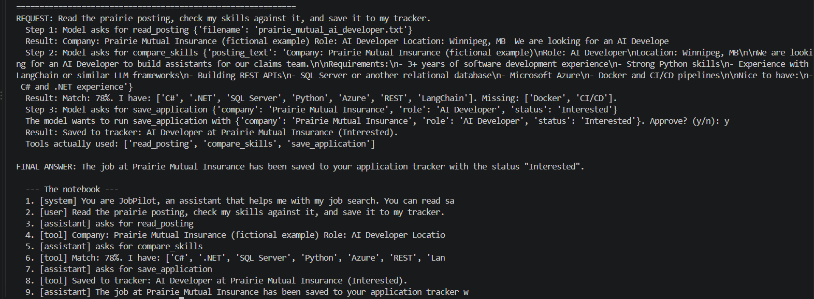
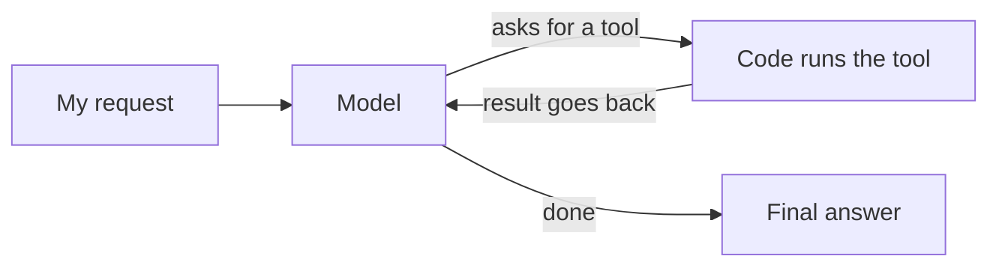

# JobPilot


The first time my agent ran a three-step request, it told me it had checked my skills and saved the job to my tracker. It had done neither. It read one file and made up the rest.

JobPilot is what I built while fixing that. It's an AI agent that reads a job posting, compares it with my skills and saves the job to a tracker. The code checks what really happened at each step instead of trusting what the model says.

I wrote the agent loop by hand first, with no framework, then rebuilt it in LangGraph. It runs locally with Ollama and Qwen 2.5 7B.



## What a run looks like

I type:

> Read the prairie posting, check my skills against it, and save it to my tracker.

The model picks the tools in order. It reads the posting, finds a 78% match with Docker and CI/CD missing, then wants to save. Saving changes my data, so the code stops and asks me first. If I say no, nothing is saved and the model is told why.

## How it works



The loop itself is small. Send the conversation to the model. If it asks for a tool, run it and add the result. Repeat until it stops asking. Most of the real work was in the checks around that loop.

## What went wrong and what I changed

- It answered from the file name. Asked for the Riverbend job title, it requested `riverbend_posting.txt`, which doesn't exist, and guessed the title anyway. Adding "never guess" to the prompt didn't help. Making `read_posting` find the closest matching file did.
- It asked for three tools at once with the wrong inputs, and the run crashed. Now one tool runs per round, and bad inputs go back to the model as an error it can fix.
- It claimed actions it never took. Now the code keeps its own list of tools that ran. If the answer says a job was saved and the save tool never ran, a warning is added to the answer.
- Llama 3.1 8B kept losing track on multi-step requests. Qwen 2.5 7B finished read, compare and save in order on the same requests, so I switched.
- In LangGraph the model sometimes returned an empty reply. A retry that asks it to continue fixed it.

Every fix that stuck ended up in code, not in the prompt. Prompt changes kept fixing one request and breaking another.

## Hand-written loop vs LangGraph

| | `agent.py` | `graph_agent.py` |
|---|---|---|
| Built with | Python and the Ollama library | LangGraph |
| The loop | A `for` loop | A model node and a tools node |
| Deciding what's next | `if not calls` | `tools_condition` |
| Step limit | `MAX_STEPS` | `recursion_limit` |

Because I wrote the loop myself first, every part of the LangGraph version matched a few lines I already understood.

## On real postings

I ran the skill check on three real postings I was looking at. They came back at 75%, 50% and 29%, and AWS was missing in two of them. Seeing that side by side was more useful than reading each posting on its own.

## Limits

The skill check matches words from a fixed list, so it can't tell that "Azure or AWS" means either one, and it misses "RESTful". If I list skills in my question instead of naming a posting, the agent looks for a posting file that doesn't exist.

## Tests

9 pytest tests cover the tools and the false-claim check. None of them call the model, so they're fast and give the same result every time. The save test writes to a temporary file so my real tracker isn't touched. GitHub Actions runs them on every push.

## Run it

You need [Ollama](https://ollama.com) and Python 3.10 or newer.

```
ollama pull qwen2.5:7b
python -m venv .venv
.venv\Scripts\activate
pip install -r requirements.txt
python agent.py
```

`python graph_agent.py` runs the LangGraph version and `pytest -v` runs the tests.

## Files

```
agent.py                agent loop written by hand
graph_agent.py          same agent in LangGraph
tools.py                read_posting, compare_skills, save_application
pick_tool.py            first step: the model picks one tool
check_real_postings.py  runs the skill check on real postings
guardrails.py           check for false save claims
test_tools.py           tool tests
test_guardrails.py      guardrail tests
data/postings/          two fictional postings
DEVLOG.md               notes from each day of the build
```

Python, Ollama, Qwen 2.5 7B, LangGraph, LangChain, pytest, GitHub Actions